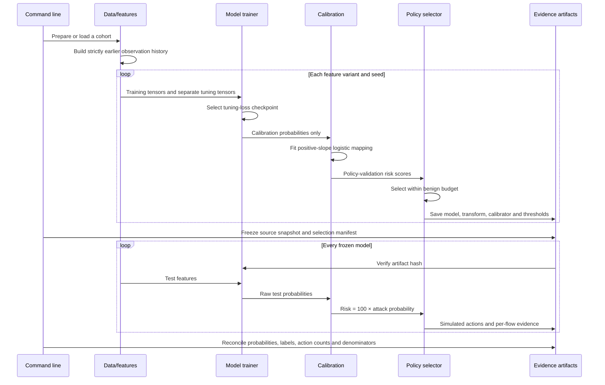

# Implemented architecture

This is the original architecture record. The bounded persistent history,
configuration/provenance and completion fixes are documented in V2_WORKFLOW.md.

This describes the new package, not the missing original Python scripts.

```mermaid
flowchart LR
  ZIP[Public corrected CICIDS2017 ZIP] --> DATA[data.prepare: schema, labels, deduplication, reservoirs]
  DATA --> SPLITS[Saved random and temporal cohorts]
  SPLITS --> CTX[features.causal_history: earlier completion times]
  CTX --> MAT[features.matrix: 78 / 92 / 100 columns]
  MAT --> FIT[TrainOnlyTransform.fit on training]
  FIT --> MOD[models.fit_model]
  TUNE[Tuning split] --> MOD
  MOD --> CAL[BinaryCalibrator: separate calibration split]
  CAL --> RISK[100 times attack probability]
  RISK --> POL[policy.select_policy on policy split]
  POL --> FREEZE[Models, source snapshot, hashes, selected thresholds]
  FREEZE --> TEST[Held-out scoring within each run]
  TEST --> MET[Classifier and action-assignment metrics]
  MET --> VERIFY[verify_results: independent export reconciliation]
```

## Shared contracts

| Interface | Producer | Consumer | Contract |
|---|---|---|---|
| Raw flow | Pinned CSV archive | data.prepare | Corrected header names; duration in microseconds; timestamp string; Label; source/destination IP metadata |
| Canonical feature signature | data.signature | Deduplication and hash partitioner | 64-bit signature of ordered float32 numeric features; no label/metadata |
| Prepared record | data.prepare | load_prepared / experiment.run | 78 numeric base columns plus `__label`, `__source`, `__src_ip`, `__dst_ip`, `__ready_at`, `__row_id`, `__split` |
| Completion time | Timestamp + duration | causal_history / temporal split | Absolute ordering of dataset timestamps; timezone not independently established; no cross-network clock claim |
| Observation stream | Uniform reservoir | causal_history | Earlier completed sampled flows; randomized training-only queries do not update the reference stream |
| Feature matrices | features.matrix | TrainOnlyTransform | Ordered [N,78], [N,92] or [N,100] matrices on the same protocol rows |
| Fitted transformations | TrainOnlyTransform.fit | All subsequent splits | Training medians, rate caps, scaler and exact feature order |
| Encoded model label | experiment.run | fit_model | Consecutive training-class indices; unknown evaluation labels map to -1 and remain named in reports |
| Probability vector | model.predict_proba | attack_probability | [N,C], finite, each row sums to 1, exact saved class-column mapping including BENIGN |
| Binary probability | attack_probability / BinaryCalibrator | Risk policy and binary metrics | Raw = 1-pBENIGN; calibrated mapping fits only calibration records; strictly nondecreasing by design |
| Risk score | risk_score | decide / select_policy | Floating score in [0,100], no rounding, invalid values rejected |
| Threshold configuration | select_policy | decide | Ordered monitor < rate_limit < block, inclusive lower action boundaries |
| Decision | decide | Exporter / policy_metrics | Integer 0..3 mapped to Allow, Monitor, Rate-limit, Block; simulation only |
| Metrics | metrics.py | JSON/CSV/plots/verifier | Numerators and denominators retained; undefined rates null; assumptions disclosed |
| Frozen bundle | experiment.run | verify / offline score | Local trusted joblib artifacts, hash-checked; source snapshot and dependency versions saved |

## File responsibilities

`data.py` owns acquisition identity, label policy, cleaning, deduplication and sampling. `features.py` owns flow equations, causal history and fitted transforms. `models.py` owns controlled estimators, checkpoints and monotonic calibration. `policy.py` owns risk/action contracts and validation selection. `metrics.py` owns classifier/action metrics and uncertainty. `experiment.py` orchestrates frozen evaluation. `plots.py` creates figures from saved evidence. `verify.py` reconciles the exports. `inference.py` scores new completed-flow batches in simulation. `cli.py` exposes download, prepare, run, verify and score commands.

Required runtime libraries are NumPy, pandas, scikit-learn, SciPy, Matplotlib, joblib and threadpoolctl. pytest is for development. TensorFlow/Keras, Jupyter, Seaborn, Snort, pfSense, Wireshark, Mininet and iptables are not used by this implementation. No external account or live network/firewall is required after the dataset download.
