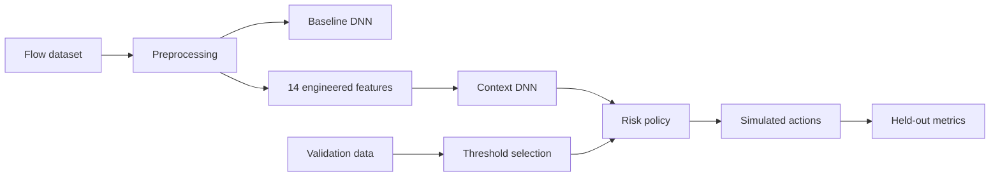

# Original Team CSEUG49 material: limited inspection report

This report concerns the supplied presentation `D:/Team_49 (5) [Autosaved].pptx` and the filename screenshot. It does not attribute the newly implemented package to the missing original source. Slide numbers below mean physical positions 1–33 because some slide footers repeat older numbering.

## 1. Project overview and inspection scope

The stated objective is to compare baseline/context DNN classification, convert predictions to risk-based simulated actions, select policy thresholds on validation data and evaluate held-out flows. The pasted request's code-source field was a placeholder. The user confirmed that the Python files were unavailable. No original branch, commit, notebook, configuration, model or result export could be inspected. The screenshot records filenames, not source contents.

The PPTX package contains 33 slides and six raster images: two institutional logos, one workflow diagram and three result/policy graphics. It contains no embedded code/workbook artifacts and no speaker-note files. Its external relationships did not supply a GitHub/GitLab source link. Text, tables, diagram text and all embedded images were inspected without executing project code.

## 2. Repository inventory

No original repository was provided. The screenshot supports only this unverified listing:

```text
unknown project location/
  preprocess.py
  train_dnn.py
  train_rnn.py
  train_lstm.py
  adaptive_firewall.py
```

| Filename | Inferred responsibility, solely from its name | Missing evidence |
|---|---|---|
| preprocess.py | Data loading and transformations | Functions, schema, split logic, saved scaler |
| train_dnn.py | DNN training | Layers, loss, optimizer, data inputs, checkpoint |
| train_rnn.py | RNN training or comparison | Actual sequence construction and callers |
| train_lstm.py | LSTM training or comparison | Timesteps, architecture, results |
| adaptive_firewall.py | Risk/policy assignment | Formula, cutoffs, integrations, logs |

No file sizes shown in the screenshot establish contents. Functions, callers, entry points, stale outputs, dependency files, tests, caches and hidden configuration remain unknown.

## 3. Architecture and dependency map

This is the **documented** architecture, not a traced call graph:



Slides 19 and 21 list Python, TensorFlow/scikit-learn, NumPy/pandas, Jupyter, plotting libraries and network tools. Imports, versions and required/optional dependencies cannot be verified. RNN/LSTM appear in architectural claims and filenames. Quantum/classical work appears as literature/proposed direction, not accessible implementation.

## 4. End-to-end execution flow

```mermaid
sequenceDiagram
  participant D as Dataset
  participant P as Preparation
  participant M as DNNs
  participant V as Validation policy
  participant T as Held-out test
  Note over D,T: Slide-described sequence only; original code unavailable
  D->>P: Flow records and labels
  P->>M: Baseline and enriched matrices
  M->>V: Predictions and risk scores
  V->>V: Select cutoffs
  V->>T: Fix selected policy
  M->>T: Test predictions
  T->>T: Assign simulated actions and aggregate metrics
```

Slide 18 gives this ordering. Slide 27 states policy selection precedes held-out evaluation. Neither establishes the original execution order, artifact paths or absence of manual notebook state.

## 5. Three workstreams

### A. Data and features

Slide 23 names CSE-CIC-IDS2018, 172,628 flows, 15 traffic classes, 77 original features and 91 total features. Its train/validation/test counts are 117,386 / 20,716 / 34,526. They sum to 172,628 and approximate 68% / 12% / 20%. Slide 24 says 14 features were engineered, rate caps fit on training and row/label alignment was checked. Arithmetic supports 77+14=91, but no column names, formulas, units, caps, alignment evidence or transformation artifacts are provided.

Slide 22 describes historical firewall `Action` labels such as allow/drop/reset-both while listing multiple datasets. Those are conceptually different from benign/attack intrusion labels and from a new policy's output actions. The original program's actual dataset usage, mapping, seeds, sampling, missing/infinite handling, scaling, balancing, deduplication and split strategy cannot be established. Temporal/history context and leakage cannot be assessed from the diagram alone.

### B. Models and firewall policy

Slide 25's static graphic says baseline accuracy is marginally higher, while context macro precision and macro F1 improve. It supplies no exact score labels, numerical table or saved classifier report. Architecture, class order, class weights, checkpoints, stopping conditions and probability/risk formulas are absent.

Slides 26 and 27 identify cutoffs Monitor=25, Rate-limit=60 and Block=79. The screenshot graphic describes Allow as permit, Monitor as observation, Rate-limit as simulated restriction and Block as marking for blocking. Comparison operators, equality behavior, missing-score handling and actual enforcement calls remain unknown. The newly implemented package explicitly defines these details; that does not recover the original behavior.

Slides 16, 18 and 29 explicitly say simulation and no live integration. Slides 17 and 19 describe packet/payload parsing, iptables-style enforcement and feedback. The deck therefore mixes a proposed live architecture with an explicitly simulated evaluated scope. No original call path to Wireshark, Mininet, Snort, pfSense, iptables or cloud APIs was available. Continuous monitoring, runtime updates and retraining are unverified.

### C. Evaluation and results

Slide 26 reports selected validation containment 95.10% and benign disruption 23.50%, with cutoffs 25/60/79. Candidate-search logic, constraints, ranking, tie-breakers and denominators are not supplied. The graphic is presentation evidence rather than an independent saved experiment.

Slide 28 reports 34,526 test flows: Allow 1,829; Monitor 2,655; Rate-limit 2,498; Block 27,544. These sum correctly. Overall Block proportion is 79.78%, which is different from attack-only blocking of 89.62% because its denominator includes benign flows.

The four reported percentages are mathematically compatible **if** containment/disruption include Rate-limit + Block. One compatible aggregate table is:

| Group | Attack | Benign | Total |
|---|---:|---:|---:|
| Block | 27,358 | 186 | 27,544 |
| Rate-limit | 1,711 | 787 | 2,498 |
| Allow + Monitor | 1,456 | 3,028 | 4,484 |
| Total | 30,525 | 4,001 | 34,526 |

This yields 27,358/30,525=89.624898% blocking; 29,069/30,525=95.230139% containment; 186/4,001=4.648838% benign false-blocking; 973/4,001=24.318920% benign disruption. **This table was inferred conditionally, not recovered from an artifact.** It does not determine separate attack/benign counts for Allow and Monitor. The original code's definitions, class mapping and empty-denominator behavior remain unknown.

Slide 15's 76.7–79.8% model accuracy range and 2.86% FPR lack a traceable run/dataset denominator and cannot be assumed to belong to the later DNN/policy experiment.

## 6. Shared data contracts and dependencies

The original raw schema, encoded label mapping, benign index, feature order, split IDs, scaler contract, probability column order, risk units and exported decision schema are unavailable. Matrix widths 77 and 91 and 15 traffic classes are slide claims. Even the supposed tensor shape `[N,77]` or `[N,91]` is an inference, not an inspected object. Exact Python/library versions, local file paths, checkpoints and external-service dependencies are unknown.

## 7. Slide-to-code verification

| Slide claim | Code location | Saved output / other evidence | Finding |
|---|---|---|---|
| CSE-CIC-IDS2018; 172,628 flows; 15 classes | Unavailable | Slide 23 text | Documented, unverified |
| 117,386 / 20,716 / 34,526 split | Unavailable | Slide 23 | Sum correct; split construction unknown |
| 77 + 14 = 91 features | Unavailable | Slides 23–25 | Sum correct; actual columns unknown |
| Training-fitted caps; aligned rows | Unavailable | Slide 24 | No saved fitted/row-ID evidence |
| Context macro precision/F1 improvement | Unavailable | Slide 25 raster chart | Qualitative claim only |
| Thresholds 25 / 60 / 79 | Unavailable | Slides 26–27 raster graphics | Constants documented; semantics unknown |
| Validation 95.10% / 23.50% | Unavailable | Slide 26 | No independent result export |
| Held-out action totals | Unavailable | Slide 28 | Totals reconcile arithmetically |
| Four held-out policy rates | Unavailable | Slide 28 | Conditional arithmetic compatibility, not validation |
| Live enforcement and feedback | Unavailable | Slides 17/19 versus 16/18/29 | Scope contradiction |
| RNN/LSTM training | Unavailable | Filename screenshot and slide 19 | Existence of executable code unverified |
| Quantum/classical model | Unavailable | Slides 5/15 and references | Proposed/literature material only |

## 8. Implementation status

| Component | Expected responsibility | Actual implementation evidence | Status | Relevant files/material |
|---|---|---|---|---|
| Data preparation | Load, clean, split and fit transformations | Filename and claims only | Unclear | preprocess.py name; slides 23–24 |
| Baseline/context DNNs | Train and produce probabilities | Result graphic and filename only | Unclear | train_dnn.py name; slide 25 |
| RNN/LSTM comparisons | Train temporal models | Filenames only | Unclear | train_rnn.py / train_lstm.py names |
| Risk engine | Convert probabilities to score | Descriptive pipeline | Documented only | Slides 16/18/20 |
| Policy selection | Tune validation cutoffs | Selected cutoffs and graphic | Documented only | Slides 26–27 |
| Held-out evaluation | Produce reproducible counts/metrics | Slide text only | Documented only | Slide 28 |
| Live integration | Enforce actions and update rules | Explicitly outside evaluated scope | Documented only | Slides 17/19/29 |
| Quantum/classical method | Implement proposed hybrid model | Literature/proposal statements | Documented only | Slides 5/15 |

Lack of source does not justify labeling a component “Not implemented” or “Fully implemented.”

## 9. Confirmed issues and potential risks

- **Missing implementation access:** the request contains a code-source placeholder. All original code-level claims remain unverified.
- **Conflicting scope:** slides 17/19 describe live functionality while slides 16/18/29 delimit simulation. This matters for viva/paper claims of enforcement effectiveness.
- **Dataset/label ambiguity:** slide 22's historical firewall actions differ from slide 23's intrusion classes. The actual producer/consumer mappings are unknown.
- **Untraceable earlier figures:** slide 15 lacks a clear connection to the later experiment. They should not be combined without saved run evidence.
- **Unspecified history:** slide 24 does not identify the engineered columns. A workflow drawing cannot establish causal context or temporal learning.
- **Missing metric denominators:** slide 28's totals alone do not verify attack/benign rates. The conditional reconciliation above is not a replacement for class-by-action exports.
- **Potential leakage, overfitting and poor generalization:** these require source/data inspection or execution and are hypotheses about the original project, not confirmed code defects.

## 10. Entry points and overall assessment

The filenames suggest preprocessing, training and policy scripts, but their invocation order, arguments and prerequisites are unknown. Commands such as `python preprocess.py`, `python train_dnn.py` and `python adaptive_firewall.py` are only possible future command shapes, not verified runnable entry points. They were not executed because the original files were not supplied.

The original materials support an explanation of a proposed/evaluated simulated pipeline and internally consistent aggregate counts. They do not establish an inspectable original implementation or reproducible experimental results. The separate new package supplies its own explicit contracts, commands and results under a different, documented dataset and protocol.
